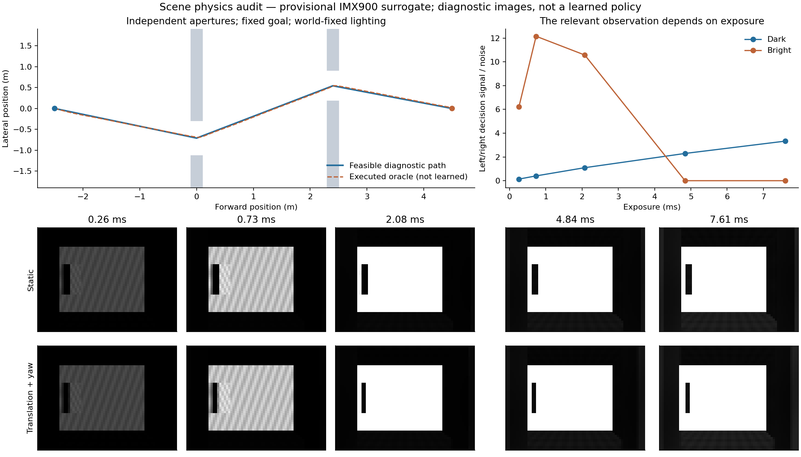

# Flight-intent-conditioned closed-loop joint learning

> Primary-scene update (2026-10-21): use the
> [sparse-pole protocol](SPARSE_POLES_PROTOCOL.md) for further development.
> The two-aperture task below is retained as historical development evidence,
> including its failed learned-policy pilot. Do not keep training that task as
> the default or cite its feasibility witness as learned navigation. The new
> task uses the same actor and sensing/dynamics paths, with three round poles.
> The original scope was full vs nondifferentiable sensing gradients. An
> opt-in actor-critic estimator now exists only to make the sensing-cut arm a
> legitimate learned-camera control; it is not a separate algorithm claim.

Development branch: `codex/imx900-intent-closed-loop`, based on `d989ad9`
of `active-sensing-grayscale-imx900`. Date: 2026-10-21.

### Optional closed-loop backward mode

`--joint_backward consistent --grad_decay 1` is an opt-in research mode for
`intent_shared` on differentiable scenes. The default remains `legacy`.
It preserves position feedback in the goal-direction input and past applied
camera settings in the smoothing/queue recurrence; it also differentiates the
approach-speed weighting in the collision objective instead of stopping its
gradient. No forward values, observations, loss weights, deployed parameters
or terminal rules change. Both full and nondifferentiable sensing receive the
same mode in a comparison.

This is **not an exact derivative of the hard navigation objective**: hard
visibility/termination, saturation STE and the optional image-warp pose
estimator still have their documented limitations. Tests compare local
derivatives against finite differences on smooth examples and verify identical
forward trajectories. Policy-learning results, including negative results,
are tracked in `SPARSE_POLES_ITERATION_2026_10_21.md`.

## Question and current status

Can a drone choose exposure/gain for an upcoming maneuver, and learn to change
its maneuver to obtain a useful observation, using a navigation objective?

This branch implements the learning paths and an independently checked scene.
It does **not** yet establish learned sensing/motion coordination, superiority
over reinforcement learning, or real-camera deployment readiness. An opt-in
short-horizon actor-critic estimator is available for a fair diagnostic: the
full arm keeps pathwise image gradients, while the sensing-cut arm uses the
same camera exploration and a score-function return estimator. Historical
five-seed full/detached evidence concerns a different, frozen-flight method.
Those checkpoints and results are not modified or reused as evidence here.

## Policy and learning paths

```text
current/previous grayscale + motion/goal observations
                         |
                   shared CNN + GRU
                     /          \
      bounded acceleration      camera head
               |                ^      |
       flight-command queue     |      exposure/gain command queue
               |          proposed     |
           dynamics       acceleration |
               |          + velocity   |
               |          prediction   |
               v                       v
         pose / velocity -> exposure integration -> IMX900 surrogate
                                                       |
                                              next grayscale frame
                                                       |
                                              next flight action
                                                       |
                                                 navigation loss
```

`intent_model.py` uses a shared grayscale CNN and a 128-dimensional GRU.
The flight head outputs three bounded local acceleration commands. The camera
head receives shared memory, the actual proposed command, a short kinematic
velocity prediction, current applied E/G, motion state, and known requested /
pending camera settings and nominal command timing. The default intent horizon
is 0.25 s. This is a command-conditioned kinematic proxy, **not** an optimized
future trajectory or an uncertainty-aware planner.

Camera settings/timeline do not directly enter the flight head or its recurrent
state. They affect later flight decisions through pixels. Gate centers, surface
IDs, depth and lighting labels are simulator internals, never actor inputs.
The goal is identical for all aperture choices.

Both flight and camera parameters, including the shared visual memory, are
trained together by full BPTT by default. The optional short-horizon mode
truncates the differentiable rollout at a fixed control-step horizon and learns
a training-only latent cost critic. It does not add a deployed input or a
camera target. There is no image-quality target or E/G teacher.
A newly disclosed common flight-only imitation warm start is being tested on
the sparse-pole task; the original gate pilots did not use it. No PPO is used. Existing velocity,
collision and action-regularity losses are retained; an explicit terminal
goal-distance term is enabled for this task. Camera smoothness is a disclosed
regularizer. Shared parameters are included in the `flight_parameter_sha256`
group; camera-specific parameters are `cam_pre` and `fc_cam`.

Two observation-related learning paths are available:

1. Future navigation loss → image → exposure/gain → camera parameters.
2. Future navigation loss → image → pose/velocity/attitude → earlier flight
   actions. This includes the effect of motion during an exposure.

`observation_grad_mode=detached` cuts the second path while preserving forward
pixels. `sensor_grad_mode=detached` cuts E/G at the image-formation boundary.
They are separate interventions. Cutting a gradient is not an RL baseline.

Removing explicit intent keeps every parameter and shared memory unchanged.
Because the command is a function of shared memory, this ablation tests a
structured conditioning bias, **not access to otherwise unavailable information**.

## Scene: independently offset apertures in mixed light

`scene_layout=intent_gates` is optional; old configs retain their old scene.

| Quantity | Default |
| --- | --- |
| Start / goal x | -2.5 / 4.5 m |
| Gate x | 0 / 2.4 m |
| Lateral center of each aperture | Independent sign; magnitude 0.50–0.75 m |
| Aperture half-width / half-height | 0.36–0.44 / 0.55 m |
| Drone body | Sphere, radius 0.12 m |
| Command bound | Each local acceleration component ≤ 3.5 m/s² |
| Desired speed | 2 m/s; a loss target, **not a hard speed cap** |
| Deadline / nominal cadence | 8 s / 15 Hz |
| Illumination | Dark, bright, dark→bright, bright→dark |

The corridor is enclosed. Going around the wall or flying over it is blocked.
The renderer and collision checker use the same boxes. Continuous conservative
body sweeps prevent tunnelling. Sweeps use radius-expanded boxes, which are
slightly more conservative than a spherical body near corners. Seventeen
samples supply signed transition-clearance gradients; a continuous sweep
supplies the terminal decision. Collision takes precedence over reaching goal.
The action causing termination enters the loss; subsequent losses are masked.

Illumination belongs to world surfaces, not the drone's x coordinate. An initial
shortcut was removed: an always-bright background could reveal a dark opening
as a silhouette. Corridor/background lighting now follows the gate conditions.
This does not eliminate all useful silhouette cues in mixed light; they are
legitimate visible measurements and their exposure dependence is audited.

Why this is a useful candidate task:

- The next opening cannot be inferred from the goal or a fixed trajectory.
- Looking through the first opening reveals a second independently placed one.
- Long exposures improve dark-scene decision cues but saturate bright ones.
- Translation and turning during an exposure change the actual image.
- A camera command affects a later observation, so purely reactive tuning can
  be late. Motion and sensing can in principle coordinate before a maneuver.

These properties create a testable opportunity. They do **not** prove that
intent conditioning is necessary, that conventional AE cannot succeed, or
that no fixed E/G setting works. Those require trained, matched comparisons.

## Image formation and timing

The new scene traces hard ray/box intersections in PyTorch and applies the
existing procedural reflectance model. Integration averages past poses during
the physical exposure interval ending at the current simulated frame. It uses
exposure microseconds from the calibration profile, translational velocity,
body angular rate and camera rotation. Three midpoint samples are the default;
9/17-sample convergence is reported by the audit. Gradient checkpointing limits
memory use. The legacy isotropic blur is **not applied again**.

The model assumes constant velocity/angular rate over exposures up to 8 ms.
Hard visibility gives piecewise local derivatives inside each visibility
region; it supplies no silhouette/disocclusion derivative. This is a material
limitation of direct optimization, especially when learning aperture discovery.
The new PyTorch dynamics/attitude equations match the original CUDA forward
model while retaining attitude/drag derivatives absent from its custom backward.
It remains a point-mass flight model, not a measured vehicle model.

The separate profile `imx900_intent_provisional.json` keeps the old provisional
radiometry and sets an **assumed** camera queue delay of one control step.
The JSON field is historically named `command_delay_frames`; in this rollout
it counts control steps. With the observation-before-command schedule, a command
issued at t first changes the frame at t+2: **133.3 ms at 15 Hz**. The flight
command also has a two-step queue, followed by actuator dynamics. Neither is
an IMX900 hardware measurement. The profile remains `calibrated: false`.
Frame reception, readout and measured clock domains are not simulated here.

Hard forward + STE backward saturation is the experiment default. The STE is a
training approximation. It must not be confused with a finite-difference
derivative of hard clipping.

## Optional short-horizon actor-critic diagnostic

`--policy_update_mode short_horizon_ac` uses a 16-step differentiable segment,
then bootstraps through `LatentCostCritic`. The full arm receives the camera
pathwise gradient. The sensing-cut arm cuts both sensor paths and estimates the
camera update with a Gaussian score function using the same sampled logit
noise. The critic is trained on the same masked task costs and is saved only
for audit; it is not part of inference.

This is an implementation of a standard first-order model-based actor-critic
pattern, not a new RL algorithm. It is useful here because it prevents a
camera-gradient cut from being confused with a camera-learning baseline.
Before any result is interpreted, the pilot manifest must verify identical
actor initialization, critic initialization, replay targets, source hashes and
evaluation episode seeds.

## Verification and development evidence

Run artifacts live under `logs/intent_joint_20261021/` in this worktree.
Config/calibration, source hashes, Git revision/status and parameter hashes are
recorded. Current tools also retain source/calibration copies so a dirty-source
run is recoverable. All training runs reported here predate that source-copy
addition and retain their source hashes instead. CUDA warn-only determinism is not a promise
of bitwise repeatability across machines.

The scene audit, with its explicit diagnostic seed, found:

- A smooth geometric witness fits the 8 s budget without swept collision.
- A privileged waypoint tracker executed the actual dynamics and command queue
  successfully in 6.4 s, with about 0.145 m minimum transition clearance.
  Four extreme aperture-sign combinations also pass dynamics regression tests.
- At fixed gain 0.05, increasing exposure from 0.258 to 7.605 ms improves dark
  left/right aperture signal/noise from about 0.136 to 3.33. In bright light the
  corresponding endpoint signal falls from about 6.21 to zero by saturation.
  This pixel-level diagnostic is not a classifier or navigation success rate.
- At 3 rad/s yaw and velocity [1.2, 1, 0] m/s, the raw-irradiance temporal
  integration difference increases with exposure. 3-vs-17 integration-sample
  MAE is about 0.00258; 9-vs-17 is about 0.00138.

The oracle and diagnostic image pairs use privileged geometry solely to check
task feasibility and sensor effects. They are never supplied to training and
must never be presented as learned-policy videos.

Navigation-gradient verification on identical realized trajectories gives:

| Intervention | Navigation loss | Camera-head gradient norm |
| --- | ---: | ---: |
| Full | 17.056326 | 0.00573488 |
| Motion→image gradient cut | 17.056326 | 0.00573493 |
| E/G boundary cut | 17.056326 | 0 |

The difference in the first flight-action gradient caused by the motion→image
path is about 2.42e-5. Forward trajectories match exactly for all three cuts.
This verifies the requested learning paths, not their practical advantage.
The historical frozen-flight wiring check also continues to pass.

Four matched 8-iteration smoke runs (batch 2, all 120 steps) completed with W&B:
joint, no-intent, motion-gradient-cut, mean-AE. All initialization hashes match;
all score **0/4 successes, 4/4 collisions** on independent paired evaluation.
They establish train/eval integration only.

A 150-iteration joint development run (batch 4, independent episode seeds
721000–721015, four episodes per lighting case) completed with **0/16 successes,
15/16 collisions, 1/16 timeout**. Most collisions occur around the first gate;
some trajectories hit corridor boundaries. All recorded loss/gradient metrics
are finite. Average loss decreases from 20.329 (first 25 iterations) to 17.480
(last 25), but average goal distance remains 4.842 m in the last window. Loss
reduction is not task completion. This is not a matched method comparison.

The [W&B development run](https://wandb.ai/sic-lab/diff-simulation/runs/nrq4btms)
and [committed development summary](intent_joint_20261021/development_results.json)
retain the checkpoint/initialization hashes, episode outcomes and runtime
provenance. The [scene audit](intent_joint_20261021/scene_audit.json) and
[gradient audit](intent_joint_20261021/gradient_check.json) have source/config
provenance alongside them. **80 project tests pass**, including finite-difference
pose/exposure integration checks, CUDA forward parity, extreme-gate executed
feasibility, final-action swept collision, and parameter/input-isolation tests.



## Reproduce

Use the verified `mappo-mpc` environment (PyTorch/CUDA and `quadsim_cuda`).
Commands below are run from this branch's repository root:

```bash
python -m pytest -q
python tools/verify_gray_navigation_gradient.py
python tools/verify_intent_closed_loop.py --out_dir logs/intent_joint/gradient_check
python tools/audit_intent_scene.py --out_dir logs/intent_joint/scene_audit

# Bounded, matched integration test. Output must be a fresh directory.
# W&B is online unless --wandb_disabled is explicitly supplied.
python tools/run_intent_pilot.py --out_dir logs/intent_joint/pilot \
  --variants joint no_intent motion_gradient_cut camera_gradient_cut fixed mean_ae blind \
  --iterations 20 --batch_size 2 --eval_episodes 8

# Default longer joint-learning configuration; no frozen backbone.
TASK=gray_joint_intent bash run.sh

# Restore checkpoint args and calibration before evaluation.
python eval.py --resume /absolute/path/to/run/final.pth --batch_size 1 \
  --eval_episodes 16 --seed 721000 \
  --scenarios dark_to_bright bright_to_dark dark bright \
  --eval_trace_csv logs/intent_joint/eval_trace.csv \
  --eval_episode_csv logs/intent_joint/eval_episodes.csv
```

## Next decision and claim boundary

First establish reliable visual navigation in this task. If direct-from-scratch
BPTT stays at collision/hover solutions, inspect terminal positions, local
collision gradients and image dependence before increasing budgets. A flat
solid wall gives a local distance gradient largely along its normal; it does
not tell a locally optimized policy how to discover a distant opening. A
disclosed visual-navigation curriculum or imitation initialization may be
needed. Neither should silently become a teacher for E/G, and final joint
learning must unfreeze the flight policy.

After navigation works, compare matched joint, no-explicit-intent,
motion-gradient-cut, camera-gradient-cut, fixed-camera, conventional AE and
blind controls on held-out aperture/light combinations. Ordinary joint RL,
and any imitation/model-based alternatives, need their own implementations and
fair budgets before claiming this is the most effective learning method.

To show coordination rather than a change in brightness, record requested and
applied E/G, maneuver commands, angular motion, measurement timing, observation
quality relevant to the next opening, and task success/time/clearance. Test
both directions: changing the upcoming maneuver should change sensing, and
removing the benefit of a useful measurement should remove the corresponding
flight behavior. A visually attractive trajectory or nonzero gradient alone
does not answer that question.

Real IMX900 calibration, real timing, HIL and flight safety gates remain
separate. No hardware capability is inferred from this provisional scene.
