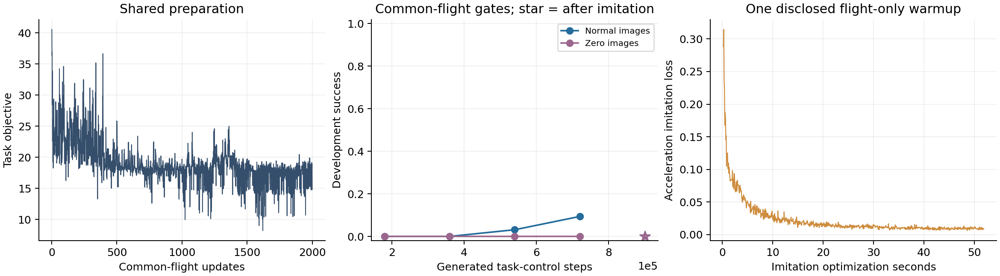

# 当前窄缝联合学习：2026-11-05执行结果

**结论：共同视觉飞行起点未建立。**

## 已证实

- 球体连续碰撞修正后，两组历史复算为 8/16、3/16；四次误停均继续运行，未直接改记成功。
- 共同准备：直接任务更新2000次；模仿更新800次；热身后任务更新500次。
- 一次热身后最终开发集：正常0/32、零图0/32；联合比较未启动。
- 教师采集的成功次数为83/128，这是教师表现，不是学习策略成绩。
- 中断后重做的已记录更新另计：40次、14400个生成控制步、210.3秒。耗时只覆盖已完成并记入日志的优化更新，不含未记录的半次更新、评估或进程启动。

|共同准备检查|图像|成功|碰撞|超时|
|---|---|---:|---:|---:|
|direct_500|gray|0/32|8|24|
|direct_500|zero|0/32|13|19|
|direct_1000|gray|0/32|23|9|
|direct_1000|zero|0/32|32|0|
|direct_1500|gray|1/32|17|14|
|direct_1500|zero|0/32|32|0|
|direct_2000|gray|3/32|24|5|
|direct_2000|zero|0/32|32|0|
|after_imitation|gray|0/32|29|3|
|after_imitation|zero|0/32|29|3|

未制作优势演示：Common flight gate failed; joint arms not started.

## 尚未证明

联合训练、梯度切断比较、64次确认评估及交叉组合均未启动；本轮不能判断可微感知的任务收益。模仿损失降低不等于闭环飞行成功；未单独评估模仿结束时的模型，不能判断失败发生在模仿阶段还是后续任务更新阶段。本轮只有单个训练seed和固定开发样本，没有跨seed统计、RL算法竞争或真机证据。相机仍未实测标定。

## 下一项唯一工作

定位基础视觉飞行的学习障碍；不启动联合比较。

完整配置、源码快照、逐步训练指标和检查点在运行目录：
`/home/zhaoguodong/.codex/worktrees/imx900-intent-joint/DiffPhysDrone/logs/joint_slit_learning_20261105`

