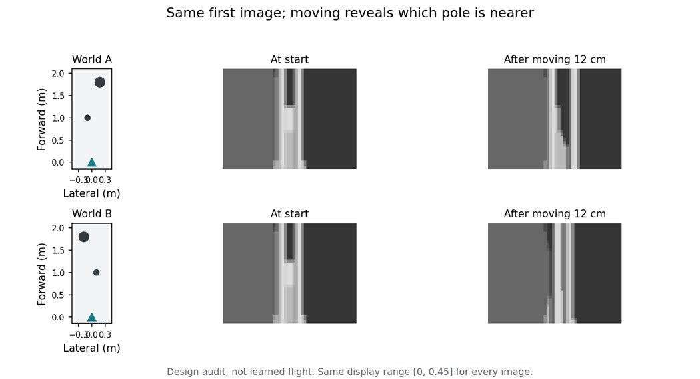

# 2026-10-21：先学会绕柱，再检查是否会为了看清而改变飞法

当前**尚未证明**无人机学会了飞行与拍摄的有效配合。旧的五种子冻结飞行实验、
checkpoint 和 IMX900 provisional profile 不变。本页只记录新研究分支的开发结果。
传感器仍然没有实测标定，`calibrated: false`。

## 已完成的训练

| 实验 | 灰度图成功次数 | 对照 | 能说明什么 |
| --- | ---: | ---: | --- |
| 三柱，从零训练 160 次，batch 4，固定相机 | 0/40 | 尚未比较感知梯度 | 这轮训练没有学会绕柱 |
| 128 条飞行示范，600 次更新 | 9/40 | 同一网络全黑输入 4/40 | 有进步，但不可靠 |
| 加入 128 条纠偏示范，再更新 600 次 | 31/40 | 同一网络全黑输入 0/40 | 网络确实利用图像飞行 |
| 上述共同起点，亮暗场景，更新 100 次 | full 13/40 | nondiff 10/40 | 尚无可靠优势 |
| 相机学习率提高 20 倍，其余预算相同 | full 11/40 | nondiff 13/40 | 单纯提高相机学习速度没有解决问题 |

后三柱学习对照均使用同一个 200,605 参数 actor。共同示范只提供飞行加速度，
不提供曝光/增益答案；相机专属参数在示范学习中冻结。纠偏数据中，每步有 50%
概率使用旧网络动作，教师对这些实际访问状态给出加速度标签。

两次感知梯度对照各自严格匹配初始化、训练 seed 101、100 次更新、batch 4 和
48,000 条生成的状态转移。full 保留 E/G→图像和运动→图像；nondiff 同时切断这两条
梯度，保留动力学梯度和普通网络参数梯度。后者没有相机导航梯度估计器，只能收到
平滑项和权重衰减，不能称为 RL 或一个充分训练的黑盒相机优化器。

两轮 paired episode 差值区间分别约为 **−7.5～22.5 pp**、**−20～10 pp**。
这是单个训练 seed 的开发筛选，不是跨训练重复的统计结论。评估 seeds 分别为
751000–751039、761000–761039，每类光照 10 次；全部结果保留，未挑选成功示例。

**相同帧数不等于相同计算时间。** 第一轮 full/nondiff 更新耗时约 415/168 s，
第二轮约 396/165 s。因此当前也没有“相同耗时下 full 更有效”的证据。正式声称效率
优势之前，还必须给 nondiff 相同耗时的预算，并报告两种预算下的学习曲线。

## 为什么三柱任务没有证明目标

把曝光期间的运动积分去掉、保留相同的曝光信号和噪声，40 个 CPU paired episode
的成功/失败逐个完全不变，配对轨迹平均仅相差约 0.4 mm。该 CPU 检查与上述 CUDA
主对照的随机布局不同，只能在两个 CPU 条件之间进行配对比较。

这不能证明运动模糊在所有参数下无关，但说明当前 checkpoint 并未表现出可观的
“为了拍清而改变飞法”。成功率、梯度非零和曝光变化都不能代替该证据。

## 新的两柱任务

`configs/gray_joint_parallax.args` 现在可直接运行：

- 两根柱子分别在起点前方约 1.0 m 和 1.8 m，距离各有 ±0.05 m 变化。
- 哪根在左、哪根在右随机变化。近柱较细，远柱较粗，起点处的投影大小和方向保持相同。
- 单张起点图像无法可靠判断远近。横向移动约 12 cm 后，两根柱子在画面中移动幅度不同。
- 可见且参与碰撞的飞行边界宽 0.76 m，禁止一个固定外侧路线同时绕过两种排列。
- 柱子直径约 0.114–0.222 m。保持水平相机、均匀材料及空间均匀光照，避免柱脚、
  纹理尺度或明暗分区提前泄露远近。这是精简辨识任务，不是自然树林模拟。

初始 policy 图像最大差约 3.46e−6；横移后平均差约 0.039。知道几何位置的测试
控制器在 64 个带距离变化的布局中全部完成，最小实际连续碰撞间隙约 0.019 m。
这是可飞性检查，不能算作学习成果。原三柱网络直接进入新任务为 0/40。

## 网络能否读出移动带来的信息

冻结上述三柱网络，用与柱子排列无关的、有限幅的侧移采集 384 次序列。只在 256
个序列上拟合一个额外的线性读出器，用剩余 128 个测试；读出器不进入 actor。

| 网络记忆来自哪里 | 独立测试中的远近判断正确率 |
| --- | ---: |
| 移动前 | 48.44% |
| 移动后 | 98.44% |
| 飞机移动，但画面固定在起点 | 46.88% |

actor 参数完全不变，没有给飞行或相机动作标签。结果表明信息可以进入现有网络，
但不代表原来的动作输出层已经利用它，更不代表网络会自主发起这次测量。

## 当前下一步

先补“已经获得有效视角之后如何绕柱”的共同练习：采集时，前 24 步执行与障碍
排列无关的侧移，**这 24 步不提供飞行动作标签**；之后才提供绕柱加速度标签。
任何阶段都没有曝光/增益标签。后续 full/nondiff 使用相同的练习和同一个 checkpoint。

评估分开报告普通自主飞行与 `forced_probe` 条件。后者前 24 步由外部脚本控制，
只能检查获得视角后是否会绕柱，绝不能展示为学会了主动探看。trace 分别保存网络
建议动作、实际执行动作和外部覆盖标志。最终自主对照撤掉外部动作覆盖，再仅用
导航损失学习何时、如何获取视角，并用 `frozen_view` 检查新视角的实际作用。

不追加 RL/AE 实现或大规模 seed 扫描。目标仍是得到可解释的自主行为，而不是
把任何一轮小幅成功率差异包装成算法优势。

完整开发 manifest、初始化/checkpoint hash、逐 episode 结果及采集成本见
[本轮归档](sparse_poles_iteration_20261021/summary.json)。运行目录保留完整源代码快照、
calibration 快照、示范数据和 checkpoint。

## 侧移观察仍未自主学会：后续检查

上述共同练习完成后，正常自主飞行为 0/40；前 24 步由外部脚本侧移、之后交给
网络飞行为 29/40。这个差别只证明获得视角后具备绕柱能力，不能算主动观察成功。

另一个实现问题是硬可见性渲染没有轮廓移动的导数。新增可选的
`--pose_gradient_estimator warp_ste`：前向保持原始硬渲染逐像素相同，反向用固定
内部深度的局部图像重投影估计位姿影响。它依赖亮度恒定和局部线性近似，不是
精确的遮挡变化导数，也不是实测 IMX900 成像模型。深度不进入 actor。默认
`analytic` 保持旧实验不变。

64 个局部位置、相同平滑随机图像探针下，侧移 1 cm 的有限差分与估计方向的
余弦从 0.241 改善到 0.719；2 cm 时从 0.112 改善到 0.742。小步长硬栅格化
会混入像素跳变，因此这些数字仅是局部诊断。实际 48 步 rollout 的四种梯度切断
条件具有相同前向轨迹，保留相机梯度时其范数非零，切断时为零。

训练探索另提供默认关闭的相关 XY 加速度扰动；如果启用，camera intent 使用
实际扰动后的命令，两种方法必须使用相同设置。它不增加参数，推理时没有
随机扰动。本次新对照首先只改变位姿导数估计，不同时启用探索。

新增测试验证线性图案在平面上的平移/旋转梯度符号和尺度、前向逐像素一致及
梯度边界。当前完整测试为 110 项通过；下一步仍要看自主行为，不能用这些检查
替代导航成功。

## 轮廓近似导数没有单独解决自主飞行

同一起点与训练预算下，原始位姿导数对照为 full 0/40、nondiff 0/40；
改用 `warp_ste` 后仍为 full 0/40、nondiff 0/40。后一轮碰撞率分别为
80% 和 92.5%，训练耗时约 473/203 s，完整执行源文件哈希逐项一致。
这明确否定“补轮廓导数就已经解决学习”的说法。

原始导数对照中，nondiff 启动前加入了默认关闭的探索选项，两次实际源码快照
分别保留；探索幅度均为零、算法默认相同，但不能声称两次源码逐字一致。

32 个相同 CPU episode 的评分检查中，外部侧移后由已知几何控制器完成任务
得到总损失 13.46，训练后仍失败的 actor 为 22.05，旧共同 actor 为 39.77。
因此这组检查中，成功路径确实优于失败路径；没有证据把所有失败简单归结为
评分把成功排在失败之后。它仍然存在要求快速朝目标飞行的偏好和局部优化困难。

## 增加观察和转向的时间

新候选 `configs/gray_joint_parallax_lookahead.args` 把近/远柱从 1.0/1.8 m
改到 2.5/4.5 m，并将视角半角正切从 0.82 改为 0.328。对应柱子尺寸及
横向偏移保持约相同，走廊仍宽 0.76 m，目标放到 x=4.2 m。8 s 期限、
15 Hz 控制、相机时延、网络参数数目和 provisional profile 均保持原配置。

起点两种排列的最大图像差为 1.36e−5，侧移 12 cm 后平均差约 0.0335。
两种排列在近柱位置没有共同安全横向通道。先侧移 24 步再由已知几何
控制器飞行，在 64 个含距离抖动的布局中全部完成，最小实际间隙 0.017 m。
首次使用 0.06 m 规划余量时为 62/64，增到 0.08 m 后为 64/64；两次均归档。
这只是可飞性和信息检查。

曾先试过 3.0/5.4 m、半角正切 0.25 的候选，旧 actor 自主为 5/40，
外部侧移后为 1/40（CPU）。这是一次未适配场景的诊断，不拿来与新训练对照
比较。当前为 2.5/4.5 m 候选重新采集共同飞行练习；仍不提供前 24 步动作
标签或任何相机标签，后续两种方法从相同 checkpoint 开始。

## 新场景具备基础视觉飞行能力，但联合微调破坏了它

新共同 flight-only imitation 用 128 条示范、800 次更新、batch 8，优化约
82.23 s。前 24 步测量动作没有标签，camera 专属参数不变。CUDA 40 次测试为
普通自主 13/40、零图像 0/40、外部侧移后 32/40。重新训练的共同 checkpoint
不同于之前直接把旧 actor 搬进新场景的诊断。

接着 100 次更新、batch 4 的 full/nondiff 均为 0/40。在相同 CPU 测试
seeds 786000–786039、相同外部初始侧移下，微调前 actor 为 35/40，
full 微调后为 0/40。普通画面的微调前 CPU 结果为 5/40，固定起点视角后
为 0/40。CPU 与 CUDA 的随机场景和噪声不同，各自只能内部配对。

16 个相同 CPU 场景中，初始前 12 步横向加速度偏移的 full 估计导数为
+1.318，全部感知切断为 +0.741；实际 ±0.1 m/s² 扰动的总损失斜率约
+9.35，±0.3 时约 +4.02。这次诊断方向一致，但尺度差异很大。训练目标
含终止掩码、detach 和动力学梯度衰减，不能把这个导数当成硬闭环损失的
精确导数。这也没有证明该方向足以教会策略主动测量。

由于确定发生了已有绕柱能力丢失，下一轮加入可选共同 replay：缓存初始 actor
在已有示范画面上自己的飞行动作，只在原来的有效动作区间保持一致。不增加
数据、特权标签、相机标签或部署参数；前 24 步动作仍完全不受这个项监督。
训练正则权重 1000、每次复习 4 条序列。这个权重只是本轮开发选择，并非
已验证最优。缓存目标和采样使用独立 RNG，初始化处代价约 3.62e−14，
CPU/CUDA rollout RNG 均不变，相机专属梯度为零。双方记录相同 dataset、
初始目标哈希、额外复习样本数和耗时。

代码为 `flight_replay.py`，配置为 `configs/gray_joint_parallax_replay.args`。
该配置引用本地共同数据和 checkpoint，需要先按共同 imitation 命令生成。
此阶段只检验复习是否保留技能及促进自主学习，尚未形成最终研究结论。
新增复习掩码、参数容量、camera 无标签及 RNG 测试后完整测试 114 项通过。

## 区分侧移的测量作用与绕障作用

共同 actor（尚未联合微调）在 CPU seeds 788000–788039 的测试：普通
11/40，冻结全部视角 0/40；只在前 24 步从渲染中去掉侧向平移（真实
动力学照常推进）为 3/40；前 12 步把实际横向命令改成零为 7/40；
固定相机 E/G 为 11/40。普通轨迹无任何外部动作覆盖。

“取消侧移画面”是非物理的诊断：保留实际 x、z、姿态和前向移动，只在
这段渲染里将相机 y 固定为零，并取消侧向曝光积分速度；侧向位置也会改变
侧墙视野，因此它不能单独证明是柱子视差而非其他视觉线索的作用。
动作置零同时改变避障和测量，不能把成功率差全部归因于测量。
这些结果说明已有 actor 利用了侧移相关的视觉信息，但没有证明可微微调
学到了更有效的测量，也尚未证明 E/G 与运动共同优化的收益。

## 复习保留了技能，但 full 仍输给不可微感知

CUDA paired seeds 788000–788039：full **17/40**，nondiff **27/40**，
差 −25 pp，开发用 episode bootstrap 95% 区间约 [−40, −7.5] pp。
二者的初始化、执行源码、replay 数据及初始目标哈希均一致。各 100 次更新、
batch 4、48,000 个生成导航转移，另各复习 400 条序列、33,067 个有效动作。
训练子进程耗时约 full 368 s、nondiff 178 s；包含启动及日志收尾，不等同于
纯优化器时间。不能称等计算时间，也没有效率优势。

相同 CPU 条件下，复习版 full 在外部侧移后为 36/40，初始 actor 为
35/40，说明技能保留有效。另组 CPU seeds 788000–788039 的普通自主
full 为 18/40、nondiff 20/40，去掉前 24 步侧移画面后分别 10/40、18/40；
前 12 步横向动作置零后分别 17/40、18/40；固定 E/G 后分别 18/40、20/40。
普通轨迹均无外部动作覆盖。full 依赖侧移相关画面，但固定 E/G 不损失成绩，
因此还没有相机/飞行共同配合的证据，更没有 full 更好的证据。

明暗预检查：共同 actor 的 CPU 每类 20 次，nominal 为 5/20、dark 0/20、
bright 2/20。明暗联合训练暂缓，先解决 nominal 下 full 变差的问题。

8 个固定 CPU 场景检查真实首次 AdamW 更新（包含梯度范数裁剪）后，初始
综合损失 13.499：原步长 1e−4 的 full 变为 18.518，其中导航项 11.520、
复习项 6.998；步长 1e−5 时为 13.175。另一批未用于求梯度的场景，初始
13.614，对应变为 18.931 和 13.337。nondiff 也呈现大步长破坏复习项的问题。
这里只证明当前一步大小有问题，不证明单纯调小就能收敛或让 full 领先。
下一轮使用相同共同起点和预算，仅将双方步长降到 1e−5，保留所有负结果。
