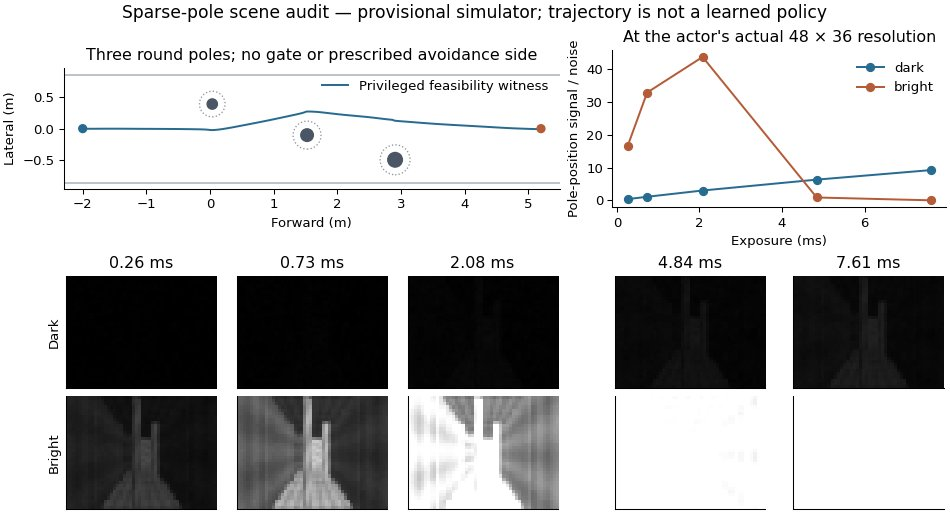

# Sparse-pole sensing–flight benchmark

> Current development results and the new selectable two-pole ambiguity task:
> [2026-10-21 iteration](SPARSE_POLES_ITERATION_2026_10_21.md). The three-pole
> task below remains the basic navigation curriculum and historical protocol.
> Its short matched pilots have not established a sensing-gradient advantage.

## Scientific question

Can learning through image formation and dynamics produce useful coordination
of the next camera measurement and the next flight maneuver, at a given policy
capacity and training budget? Camera control alone, image brightness, nonzero
gradients, and beating an untrained camera-gradient cut do not answer this.
There is no presumption that a differentiable learner must win.

This replaces the two-aperture task as the **primary candidate task** on
`codex/imx900-intent-closed-loop`. The gate implementation/results stay as a
documented unsuccessful development experiment. Historical frozen-backbone
checkpoints and all provisional calibration values stay intact.

## Scene v1: three round poles

| Item | Specification |
| --- | --- |
| Start / goal | x = −2.0 / 5.2 m, y = 0, z = 1.5 m |
| Obstacles | Three vertical round poles, diameter 0.16–0.24 m |
| Pole longitudinal locations | x = 0, 1.5, 3.0 m; independent ±0.15 m jitter |
| Pole lateral locations | Anchors −0.48, 0, +0.48 m, randomly permuted along x; independent ±0.12 m jitter |
| Arena | Width 1.7 m; floor z = 0.35 m, ceiling z = 2.65 m |
| Body | Sphere, radius 0.12 m |
| Motion budget | 8 s at 15 Hz; desired speed 2 m/s; per-axis acceleration command limit 3.5 m/s² |
| Observation | Current/previous grayscale, odometry and goal direction; 48 × 36 policy pixels |
| Camera actions | Exposure and gain, existing physical ranges and command queue |
| Light | Dark, bright, dark→bright, bright→dark; smooth light field evaluated at world surfaces |

The boundaries are rendered and participate in collision. There is no solid
wall to discover an opening in, prescribed slalom, hidden waypoint or one
correct avoidance side. Poles span floor to ceiling; flying above them is not
an unreported escape route. Rendering and clearance use the same cylinders;
XY segment-to-cylinder clearance detects collisions between sampled states.

These are controlled sparse obstacles, **not a natural-forest simulator**.
Trees, slanted branches, irregular radii/materials and unconstrained forest
layouts belong to later held-out tests, once the simple case learns.

An initial wide, uniformly random three-pole design was rejected **before
algorithm comparison**: an optimistic fixed-side geometric path cleared about
89% of layouts. The lateral stratification and visible arena remove much of
that shortcut without adding obstacles. They do not prove that all blind
trajectories fail. Record the fixed-path geometry screen and train a real blind
policy; a geometry screen is neither a learned baseline nor its upper bound.

At 2 m, pole diameters project to about 2.34–3.51 policy pixels. Starting with
1 cm branches would give only about 0.15 pixels, confounding active sensing
with spatial resolution. Do not lower resolution to manufacture a sensing gap.

Round poles also improve the local optimization geometry: away from exact
symmetry their distance gradients contain a lateral avoidance component. A
large flat wall mostly supplied a backwards normal gradient. This is a reason
to test learnability again, not a guarantee of convergence.

## What could require coordination

Longer exposure can reveal a dim pole, but can saturate the bright scene and
integrates the drone's translation and angular motion. A turn changes future
image motion; exposure/gain commands affect later frames. A useful joint policy
might prepare exposure before the turn, or change when/how it turns to obtain
a useful measurement. Both are **hypotheses to test**, not labels for ordinary
AE behavior after observing a new brightness.

Use the existing unmeasured exposure interval, 100–8000 µs. At 3 rad/s yaw,
maximum-exposure blur is only about 0.70 policy pixels. That may be too small
to drive a measurable flight adjustment. Do not multiply blur, change physical
constants, tighten space or select test seeds after seeing which learner wins.
If competent policies only adapt E/G to light, report camera adaptation; do not
call it demonstrated bidirectional coordination. If practical AE matches joint
learning, that is a valid outcome of this task.

All timing remains an explicit simulator assumption: the existing one-step
camera queue plus observation/command ordering first changes the frame two
control steps after issue (133.3 ms). It is not measured IMX900 latency.
Hard-forward/STE-backward saturation is a training approximation. The renderer
has local pose derivatives inside hard visibility regions, not silhouette or
disocclusion derivatives. Calibration remains `calibrated: false`.

## Fair comparison contract

Current user-authorized comparison (2026-10-21): **full sensing gradients vs
nondifferentiable sensing only**. Do not expand this development task to PPO,
AE or further training-seed campaigns. This is a causal gradient comparison,
not proof of superiority over other learning algorithms.

| Condition | Forward rollout | Backward learning signal |
| --- | --- | --- |
| `joint` | Same grayscale, dynamics, flight and camera commands | Task loss through image formation and dynamics |
| `nondiff_sensing` | Identical at matched initialization | Cut both E/G→image and pose/motion→image; retain dynamics and ordinary policy-weight gradients |

Use the same 200,605-parameter actor, initial checkpoint/hashes, optimizer,
training seed, layouts, image noise, action bounds, queues and evaluation seeds.
Both flight and camera heads remain trainable. Under this particular cut the
camera-specific head has no navigation-gradient estimator; it can still receive
the disclosed smoothness regularizer. Report this limitation plainly. Do not
call it reinforcement learning or a competitive derivative-free learner.
The older camera-only and motion-only cuts remain diagnostic tools.

Count generated transitions (including masked tails), optimizer steps, render
samples, GPU time and memory. Shared warm-start demonstrations and their
collection/training costs are also resources; disclose them for both conditions.
An equal number of updates does not itself imply equal elapsed compute.

A common **flight-only imitation warm start** is now being tested because
from-scratch flight learning has not yet solved this scene. The teacher uses
internal geometry to generate bounded acceleration labels; the actor receives
only ordinary grayscale/motion/goal inputs. There are **no camera targets** and
the camera-specific parameters are frozen during pretraining. Both comparison
conditions must receive exactly the same warm checkpoint. Preserve the failed
from-scratch runs and report this change in learning protocol. Final joint
training unfreezes flight and camera and uses the navigation objective.

## Development and evaluation order

1. **Scene audit:** matched rendering/collision, independent dynamically
   feasible routes, policy-resolution pole visibility, noise/saturation
   response, temporal integration convergence, and blind-route shortcut screen.
   Privileged trackers establish feasibility, never learned flight. A separately
   disclosed use for common flight imitation is allowed; count those demonstrations.
2. **Basic learning gate:** one pole, uniform nominal light, fixed camera is
   only a flight/avoidance sanity check: a fixed detour can solve it. Then use
   three poles with the same settings. Compare a trained grayscale policy with
   an independently trained blind policy and the same checkpoint with zero
   images. Require an observable vision benefit before attributing anything to
   active sensing. Small integration runs do not satisfy this gate.
3. **Lock protocol before the main comparison:** publish scene/config hashes,
   train/validation/test ranges and resource budgets. A practical starting
   evaluation is 100 unseen layouts per light scenario (400 paired episodes).
   Do not reuse audit seeds as the final test set. Avoid large multi-seed runs
   until there is a nontrivial working comparison.
4. **Matched sensing-gradient conditions:** train `joint` and
   `nondiff_sensing` from the common checkpoint under the same task objective.
   Compare actual navigation and flight behavior at matched resource budgets.
5. **Coordination evidence:** plot future turn, requested/applied E/G,
   observation timestamps, angular speed, pole localization/visibility, speed,
   clearance and outcome. On matched light/layout states, vary the upcoming
   maneuver and test whether sensing changes ahead of it. Use no-intent and
   motion→image ablations trained under the same budget. Also fix/replay camera
   schedules and compare motion, accounting for altered observations. Simple
   correlation between exposure and speed is insufficient.
6. **Generalization:** held-out layouts/light combinations first; sparse trees
   and branches later. Use the same scenarios for all learners.

Primary outcomes are success, collision, completion time and clearance. Also
show path length/energy proxies and tradeoff curves, so blind slow detours do
not appear equivalent to efficient visual flight. Any speed/time/efficiency
requirement must be fixed in advance and applied to all methods. Timeout is
failure; hovering cannot win. Retain failure trajectories, not just videos of
successful examples.

The strongest supportable conclusion would be an improvement over the tested
alternatives at matched capacity and stated resource budgets in this task. No
single task can establish a universally “most effective learning method.”

## Engineering evidence, 2026-10-21

[Scene audit](sparse_poles_20261021/scene_audit.json),
[gradient check](sparse_poles_20261021/gradient_check.json), and
[matched smoke manifest](sparse_poles_20261021/smoke_manifest.json) are archived.
Manifests record the actual pre-commit dirty revision/status and source hashes;
runtime source/calibration copies remain under `logs/sparse_poles_20261021/`.
These are engineering/development checks, not algorithm-comparison results.

- All **92 tests pass**, including analytical cylinder derivatives, CUDA
  render parity, continuous pole sweeps, last-action collision loss, terminal
  masking and no geometry leak through the goal/state.
- The main privileged tracker reaches the goal within the deadline, and all
  **16 independent feasibility layouts** pass the actual dynamics/queue check.
  This audit result is not a learned policy. The later common flight-only
  imitation protocol explicitly reuses the planner; those datasets and costs
  are recorded separately, without E/G targets.
- On 2048 random layouts and 41 fixed lateral lanes, the best optimistic
  geometry-only lane clears **58.35%** of layouts. This does not bound all blind
  controllers or replace independent blind training.
- At 48 × 36 policy resolution, a diagnostic ±0.10 m displacement of the first
  pole has ROI signal/noise about **0.36 → 9.24** as exposure increases from
  0.258 to 7.605 ms in dark light. In bright light it peaks around the sampled
  2.075 ms condition and collapses at the longest exposure. A middle exposure
  may still suffice for navigation; this is not proof that fixed E/G or AE
  fails. Images below are single noisy frames, not noise-averaged renderings.
- Navigation-gradient check: identical realized forward trajectories/loss
  (18.240044); full camera-head gradient norm **0.048024**, E/G-cut **0**;
  motion→image contribution to the first-action gradient about **0.0010234**.
  Wiring is verified, not learned anticipation or superiority.
- Two **8-update, batch-2** smoke runs (joint and fixed) have identical initial
  flight/camera hashes. Each generates 1920 transitions, including masked tails,
  and takes about 32 s of iteration time; W&B is configured online. Both score
  **0/8 success, 7/8 collisions, 1/8 timeout**. This is an integration test,
  not a failed full-budget experiment or a working visual-navigation result.
- No working visual-navigation gate, camera-learning advantage or bidirectional
  coordination has been established on this new scene. The current next step is
  the shared flight warm start followed by the matched sensing-gradient pair;
  competitive RL implementation is outside the current user-authorized scope.



## Reproduce the engineering checks

Run in the verified `mappo-mpc` environment, from this branch's root:

```bash
python -m pytest -q
python tools/audit_sparse_poles.py --out_dir logs/sparse_poles/scene_audit
python tools/verify_intent_closed_loop.py --config configs/gray_joint_poles.args \
  --out_dir logs/sparse_poles/gradient_check

# Smoke test only; default W&B logging is online.
python tools/run_intent_pilot.py --config configs/gray_joint_poles.args \
  --out_dir logs/sparse_poles/smoke --iterations 8 --batch_size 2 \
  --variants joint fixed --eval_episodes 8

# Separate bright basic-learning configuration, not a camera-learning claim.
TASK=gray_poles_basic bash run.sh

# After the single-pole control sanity check, test visual use with three poles.
TASK=gray_poles_basic RUN_EXTRA_ARGS="--pole_count 3" bash run.sh
```
